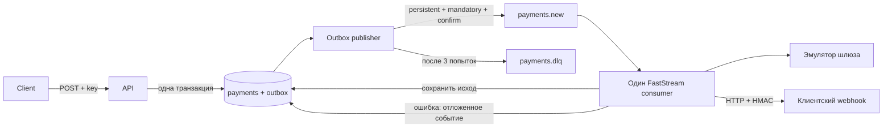

# Асинхронный процессинг платежей

Самостоятельный сервис по тестовому заданию: принимает платёж, обрабатывает его
в эмуляторе шлюза и доставляет результат по webhook. Реальных списаний нет.

**Стек:** Python 3.12+, FastAPI, Pydantic v2, SQLAlchemy 2.0 async, PostgreSQL 17,
FastStream 0.6, RabbitMQ 4.2, Alembic, Docker Compose. Версии Python-зависимостей
зафиксированы в `uv.lock`.

## Быстрый запуск

Нужны Docker Engine/Desktop и Compose v2. Python на хосте не требуется.

```sh
cp .env.example .env
docker compose --profile demo up -d --build api consumer outbox demo-webhook
docker compose ps
```

Миграции применяются отдельным одноразовым контейнером до старта приложения.
API: `http://localhost:18080`. RabbitMQ Management: `http://localhost:15673`
(логин и пароль в `.env`). Опубликованные порты привязаны к `127.0.0.1`.
PostgreSQL и AMQP доступны только внутри Compose-сети.

В `.env.example` находятся **только демонстрационные локальные** значения.
Перед внешним развёртыванием замените пароли, `API_KEY`, `WEBHOOK_SECRET`,
настройте HTTPS и разрешённых получателей webhook. `.env` исключён из Git и образа.

```sh
curl -i http://localhost:18080/health \
  -H 'X-API-Key: development-api-key-change-me'
```

Без демонстрационного получателя: `docker compose up -d --build api consumer outbox`.
Укажите свой webhook-хост в `WEBHOOK_ALLOWED_HOSTS` (JSON-массив).
Остановка без удаления данных: `docker compose --profile demo down`.

## API

Все HTTP-адреса, включая `/health` и `/openapi.json`, требуют `X-API-Key`.
Ключ один: как в ТЗ, разделения по клиентам и арендаторам нет.
OpenAPI: `GET /openapi.json` с тем же заголовком; схема содержит security scheme.
Интерактивная публичная Swagger-страница не открывается.

### Создание

```sh
curl -i http://localhost:18080/api/v1/payments \
  -H 'X-API-Key: development-api-key-change-me' \
  -H 'Idempotency-Key: order-2026-001' \
  -H 'Content-Type: application/json' \
  -d '{
    "amount": "1499.90",
    "currency": "RUB",
    "description": "Оплата заказа 001",
    "metadata": {"order_id": "001"},
    "webhook_url": "http://demo-webhook:8080/success"
  }'
```

Ответ `202 Accepted`:

```json
{
  "payment_id": "f4466219-199c-47ba-97c8-c925c6c59e12",
  "status": "pending",
  "created_at": "2026-10-29T12:00:00Z"
}
```

Сумма строго положительная, максимум 13 целых и 2 дробных знака. Лишние дробные
знаки отклоняются, а не округляются. Поддерживаются `RUB`, `USD`, `EUR`.
`description` по умолчанию пустая строка (до 1000 символов), `metadata` — объект
по умолчанию `{}` (до 16 KiB в JSON). Неизвестные поля запрещены.

`Idempotency-Key` обязателен: 1–128 печатных ASCII-символов без пробелов.
Повтор ключа с теми же данными возвращает `202` и **тот же платёж с его текущим
статусом**. `100`, `100.0`, `100.00` считаются одинаковой суммой; порядок ключей
JSON не влияет. Другие данные с тем же ключом дают `409`. Уникальное ограничение
PostgreSQL защищает и одновременные запросы. Ключ не протухает автоматически.

### Чтение

```sh
curl http://localhost:18080/api/v1/payments/ВСТАВЬТЕ_PAYMENT_ID \
  -H 'X-API-Key: development-api-key-change-me'
```

Ответ `200`: `payment_id`, `amount` (строка Decimal), `currency`, `description`,
`metadata`, `status`, `webhook_url`, `created_at`, `processed_at`,
`webhook_delivered_at`, `attempts_completed`. Даты в UTC, незаполненные — `null`.
Идемпотентный ключ, отпечаток запроса и техническая ошибка в ответ не включаются.

Ошибки: `401` — неверный/отсутствующий API key; `404` — нет платежа;
`409` — конфликт ключа; `422` — невалидное тело, URL, UUID или заголовок.
`GET /health` возвращает `503` при недоступной БД. Здоровье API не зависит
от брокера: если БД доступна, новые платежи можно принять в outbox.

## Как устроена доставка



1. API сохраняет `payments` и исходное событие `outbox` в **одной транзакции**.
   При ошибке откатываются обе записи. API не публикует напрямую в RabbitMQ.
2. Отдельный publisher выбирает готовое событие через `FOR UPDATE SKIP LOCKED`.
   Отмечает публикацию **после publisher confirm**. `mandatory` и обработка
   return защищают от ложного успеха при отсутствии маршрута.
3. Exchange `payments` направляет сообщение в `payments.new`. Exchange
   `payments.dead` — в `payments.dlq`. Очереди durable quorum, сообщения persistent.
   Очереди объявляются до публикации и старта подписчика.
4. Один consumer с `prefetch=1` делает весь сценарий: шлюз → БД → webhook.
   Эмулятор ждёт случайные 2–5 секунд. Хеш UUID платежа определяет стабильный
   исход: примерно 90% `succeeded`, 10% `failed`. Это имитирует шлюз, у которого
   UUID является ключом идемпотентности: после сбоя повтор даёт прежний исход.
5. Результат шлюза фиксируется **до** webhook. Отказ шлюза — нормальный исход
   `failed`, о нём тоже отправляется уведомление. Ошибка webhook не меняет
   успешный платёж на неуспешный и не вызывает повторную оплату.
6. Всего три попытки обработки: исходная плюс два повтора. Задержки по умолчанию
   **2 и 4 секунды**, настраиваются через `RETRY_BASE_SECONDS`. Счётчик и следующее
   событие outbox фиксируются одной транзакцией. Повтор не хранится в памяти
   процесса и переживает перезапуск. Устаревшая попытка и дубль уже завершённой
   попытки пропускаются под блокировкой строки платежа.
7. После третьей ошибки consumer атомарно сохраняет событие для DLQ в outbox.
   Оно содержит payment_id, attempt, version, error_code без URL и содержимого
   платежа. Если шлюз так и не выполнился, платёж становится `failed`.
   При исчерпании webhook-попыток сохраняется исходный результат шлюза.
8. ACK сообщения — только после commit прогресса/повтора/DLQ. Некорректные
   сообщения и неизвестные payment_id отклоняются сразу в DLQ через broker DLX
   с at-least-once dead lettering.

Одноразовый контейнер `broker-setup` задаёт политику `delivery-limit=-1` только
для `payments.new` через management API до старта рабочих процессов. Бюджет
трёх бизнес-попыток хранится в PostgreSQL; инфраструктурный NACK его не расходует.
Политика задаётся отдельно от AMQP-аргументов очереди, поскольку сериализатор
AMQP имеет ограничение на отрицательные короткие целые. При запуске вне Compose
настройте эту политику у своего брокера; адрес management API задаётся через
`RABBITMQ_MANAGEMENT_URL` (по умолчанию `http://rabbitmq:15672`).

### Границы гарантий

- Доставка событий и webhook — **at least once**. Если получатель принял HTTP,
  но ответ или commit потерян, уведомление может повториться. Принимайте
  `Idempotency-Key: <payment_id>` и дедуплицируйте уведомления у себя.
- Падение publisher между confirm и commit тоже создаёт допустимый дубль
  с прежним message_id. Consumer учитывает сохранённый номер попытки.
- При недоступной БД consumer не может надёжно увеличить счётчик. Он делает
  NACK/requeue с задержкой до восстановления БД; инфраструктурный простой
  не расходует три бизнес-попытки. Publisher повторяет публикации без лимита,
  с задержкой до 60 секунд: принятый платёж не теряется из-за простоя брокера.
- Во время вызова шлюза/HTTP блокируется **только строка текущего платежа**.
  Это намеренный простой способ сериализации для одного consumer; HTTP ограничен
  timeout 5 секунд. Для большого потока потребуются lease/claim и масштабирование.
- Настоящий платёжный провайдер должен поддерживать идемпотентный ключ. Локальная
  транзакция сама по себе не обеспечивает ровно одно внешнее списание.
- Сохранённые outbox-записи не удаляются автоматически: для production нужна
  политика архивирования, мониторинг возраста outbox и разбор DLQ оператором.
  Автоматического повторного проигрывания DLQ нет.
- Один узел RabbitMQ в Compose не обеспечивает отказоустойчивость к потере узла
  или диска. Для production нужен кластер и резервные копии PostgreSQL.

## Webhook

Тело содержит поля платежа без `webhook_url`, `attempts_completed` и
`webhook_delivered_at`. Между повторами оно не меняется. Заголовки:

```text
Content-Type: application/json
Idempotency-Key: <payment_id>
X-Webhook-Signature: sha256=<HMAC-SHA256 сырого тела с WEBHOOK_SECRET>
```

Любой `2xx` означает успешную доставку; `3xx`, `4xx`, `5xx` и сетевые ошибки
запускают повтор. Редиректы не выполняются, системные HTTP-прокси не используются.
API key не отправляется получателю. URL с credentials/fragment запрещены.
Разрешены только точные хосты из `WEBHOOK_ALLOWED_HOSTS` и порты 80/443/8080.
HTTP включается явно через `WEBHOOK_ALLOW_HTTP=true` для локального демо;
по умолчанию в коде требуется HTTPS.

Список получателей задаёт оператор. Это граница доверия: не добавляйте в него
произвольные клиентские домены или хосты, чьим DNS вы не доверяете. Для публичного
произвольного webhook-сервиса дополнительно нужен egress proxy с защитой от
SSRF/DNS rebinding. Метаданные и адреса webhook не пишутся в бизнес-логи.

Локальный `demo-webhook` проверяет HMAC и предоставляет адреса `/success`,
`/flaky` (две ошибки, затем успех), `/fail` (всегда 503), `/redirect` (302).
Его диагностические записи хранятся только в памяти, порт не опубликован наружу.

## Проверки

Полная воспроизводимая проверка с реальными PostgreSQL, RabbitMQ и HTTP:

```sh
./scripts/check.sh
```

Скрипт создаёт отдельный Compose-проект со случайными внешними портами,
проверяет миграции в обе стороны, полный Ruff, pytest на PostgreSQL и все
сценарии из [матрицы](TESTING.md), включая остановку брокера, publisher и consumer.
При завершении удаляет только свои контейнеры и сеть, **тома не удаляет**.
Для проверки запускайте со стандартными локальными настройками `.env.example`.

Только автотесты:

```sh
docker compose --profile test run --build --rm tests
docker compose --profile test stop test-postgres
docker compose --profile test rm -f test-postgres
```

Разработка с установленным [uv](https://docs.astral.sh/uv/):

```sh
uv sync --frozen
uv run ruff check .
uv run ruff format --check --diff
```

Локальный pytest требует отдельный PostgreSQL `payments_test`, заданный
в `DATABASE_URL`; он очищает **только эту тестовую БД**. Основная БД не используется.
GitHub Actions запускает `scripts/check.sh` на push и pull request.

Структура: `routers` → `services` → `repositories` → `models`; API-контракты
и DTO — в `schemas`. Репозитории возвращают ORM и не делают commit;
транзакциями управляют сервисы. Docstring на русском, бизнес-логи структурированы,
чтения и обычное создание технических записей не логируются.
